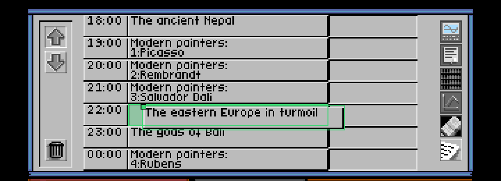

# Mad TV — a Rust port of the Amiga version

*English · [Italiano](README.it.md)*

A port for Windows (and Linux/macOS) of **Mad TV** (Rainbow Arts, 1991), the
management game in which you run a television network.

The project **contains nothing from the original game**: graphics, text, music
and the executable are read from the original disk images (ADF) that you
supply, the same way OpenRCT2 or ScummVM work.

## Status

**Phase 3 complete**: the game is playable in a window, with mouse, keyboard
and sound (TFMX music and sound effects, through Paula emulation).

| Player selection | The network building | The boss |
|---|---|---|
|  |  |  |

**Highlights** (November 2026): while you drag a panel or a videotape, the
port shows the point the game actually uses to decide where you drop it (the
top-left corner of the object, not the tip of the arrow) and colours it green
if a drop there would be accepted, red if not; in the schedule it also
highlights the target slot. The answer comes from the game itself, through a
"trial" click on a copy of the emulated machine. This is a development tool:
it is enabled with `--dev` (F9 then toggles it); by default the window shows
only the emulated game, with nothing on top.



Detailed status and next steps are in [NOTES.md](NOTES.md).

## How it works, in short

The Amiga game is written in C (Aztec C) with a few 68000 assembly routines
for the blitter. Instead of rewriting it from scratch, the port:

1. reads the original ADF disks;
2. runs the original 68000 code on the [`m68k`](https://crates.io/crates/m68k)
   core (pure Rust, MIT licence);
3. replaces AmigaOS with a Rust implementation of the few system functions the
   game uses (about 20) — no Kickstart ROM needed;
4. emulates only the custom chips the game actually touches: copper, blitter,
   bitplanes, sprites, palette, mouse, keyboard, audio.

Details are in [docs/architecture.md](docs/architecture.md); the analysis of
the two original executables (Amiga and DOS) is in
[docs/analysis.md](docs/analysis.md). The **graphics encyclopedia**
([docs/graphics/](docs/graphics/README.md)) explains how the game stores and
draws its graphics, with a catalogue of every file; the pictures are
extracted from your own disks with `cargo run --release --example extract_assets`.

## Building and running (Windows)

You need Rust (https://rustup.rs). From the project folder:

```
cargo build --release
```

Copy the two original Mad TV ADF images into the `adf\` folder (file names do
not matter: the disks are recognised by their volume names, MTV1 and MTV2).
Then start the game:

```
target\release\madtv.exe
```

You can also start it by double-clicking in Explorer: the program looks for
the `adf` folder in the current folder, next to the executable and in the
project folder (two levels above `target\release`); `save` and `shots` are
created next to `adf`. For a "portable" copy, just put `madtv.exe` and the
`adf` folder in the same folder. On error, if the program was started by
double-click, the console stays open with the message until you press Enter.

With `--intro`, the game is preceded, as on the original disk, by the Rainbow
Arts logo (a click or a key skips it) and the credits screen, which wipes down
from the top and waits for a click. The picture has a 20-pixel margin all
around; the bottom one shows the display lines beyond 200, used by the intro.
Game loading is sped up automatically (black screen for a few seconds). In the
window the emulated CPU runs at A500 speed, with an **automatic turbo** during
disk loading: screen changes and room openings are faster, while animations
and the pace of the game stay as in the original. Controls:

| Key | Effect |
|---|---|
| mouse | the game pointer follows the PC pointer |
| keyboard | as on an Amiga (player names, etc.) |
| F9 | highlights on / off (only with `--dev`) |
| F10 | automatic turbo on (default) / off |
| F11 (hold) | fast forward |
| F12 | screenshot into the `shots\` folder |

Useful options (`madtv --help` for the full list; the help text is in
Italian):

| Option | Effect |
|---|---|
| `--scale N` | window magnification (default 3: 1080×720 with the margin) |
| `--margin N` | margin around the picture in pixels (default 20, 0 for none) |
| `--full-height` | show all 256 PAL lines instead of the 200 used by the game |
| `--no-audio` | play without sound |
| `--intro` | show the Rainbow Arts logo and the credits before the game |
| `--headless --wav audio.wav` | record the game's audio to a file |
| `--cpu-speed P` | CPU speed: `auto` (window default) or a fixed percentage of an A500, e.g. `300` |
| `--headless --frames N` | no window: run N frames (50 = 1 second) and save `shots\final.png` |
| `--script "1290:goto 55 101; 1320:click; 2000:shot capo"` | automatic actions at given frames (also from a file: `--script scripts\nuova-partita.txt`) |
| `--record game.txt` | record the session (mouse, keys): the file replays it identically with `--headless --script game.txt` |
| `--originale` | run only the original game code, without the functions rewritten in Rust (slower in some places) |
| `--gpu` | draw with the GPU (wgpu) instead of in software; experimental, falls back to software if the GPU does not start |
| `--dev` | development mode: overlay layer with the drag-and-drop highlights |
| `--debug-overlay` | crosshair on the pointer tip (overlay alignment check) |
| `--trace trace.log` | log every system call made by the game |
| `--dump ram.bin` | save the emulated RAM at the end (for analysis with a disassembler) |

Game saves go into the `save\` folder; the original ADFs are never modified.

## Tests

```
cargo test
```

## Layout

```
src/
  adf.rs        Amiga disk image reader (OFS/FFS)
  hunk.rs       AmigaOS executable loader
  bus.rs        memory and address map
  custom.rs     custom chips: copper, blitter, interrupts, mouse, CIA
  render.rs     line-by-line display: bitplanes and sprites
  paula.rs      audio: Paula's 4 channels, mixing and filters
  audio.rs      output to the PC sound card (cpal)
  input.rs      mouse, keyboard, scripted actions
  iff.rs        IFF ILBM decoder (credits screen)
  window.rs     window (minifb): intro, credits, game, recording
  overlay.rs    sharp overlay layer (highlights)
  hooks.rs      game functions rewritten in Rust (hooks)
  gpu.rs        GPU renderer (wgpu): game picture + overlay, alternative to software
  enhance.rs    interface enhancements on top of the game
  machine.rs    CPU + bus + operating system; main loop
  os/           emulated AmigaOS: exec, dos, graphics, intuition, virtual file system
  main.rs       command-line program
docs/           technical documentation (English); docs/it/ = Italian version;
                docs/graphics/ = graphics encyclopedia
scripts/        sample action scripts; registrazioni/ = test recordings
examples/       analysis tools (drag_lab, probe, drop_lab, highlight_demo...)
NOTES.md        work status and next steps (NOTES.it.md in Italian)
```

Source code comments and the command-line help are in Italian.

## Licence

The code of this project is distributed under the
[GNU GPL version 3 or later](LICENSE).

The licence covers only the code written for the port (emulator, emulated
operating system, tools). Mad TV, with its graphics, text, music and original
code, belongs to its respective rights holders (Rainbow Arts) and is not
included in the repository.
