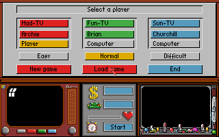
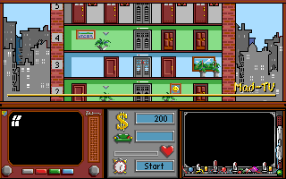
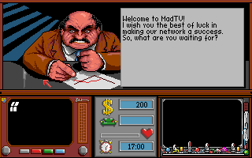

# Mad TV — porting Rust della versione Amiga

Porting per Windows (e Linux/macOS) di **Mad TV** (Rainbow Arts, 1991), il
gestionale in cui dirigi un'emittente televisiva.

Il progetto **non contiene nulla del gioco originale**: grafica, testi, musica
ed eseguibile vengono letti dalle immagini disco originali (ADF) che fornisci
tu, come fanno OpenRCT2 o ScummVM.

## Stato

**Fase 3 completata**: il gioco si gioca in una finestra, con mouse, tastiera
e audio (musica TFMX ed effetti, attraverso l'emulazione di Paula).

| Selezione dei giocatori | L'edificio della rete | Il capo |
|---|---|---|
|  |  |  |

Lo stato dettagliato e i prossimi passi sono in [NOTES.md](NOTES.md).

## Come funziona, in breve

Il gioco Amiga è scritto in C (Aztec C) con alcune routine in assembly 68000
per il blitter. Invece di riscriverlo da zero, il porting:

1. legge i dischi ADF originali;
2. esegue il codice 68000 originale con il core [`m68k`](https://crates.io/crates/m68k)
   (puro Rust, licenza MIT);
3. sostituisce AmigaOS con un'implementazione in Rust delle poche funzioni di
   sistema che il gioco usa (circa 20) — niente ROM Kickstart;
4. emula solo i chip custom che il gioco tocca davvero: copper, blitter,
   bitplane, sprite, palette, mouse, tastiera, audio.

I dettagli sono in [docs/architettura.md](docs/architettura.md); l'analisi dei
due eseguibili originali (Amiga e DOS) in [docs/analisi.md](docs/analisi.md).

## Compilare ed eseguire (Windows)

Serve Rust (https://rustup.rs). Dalla cartella del progetto:

```
cargo build --release
```

Copia le due immagini ADF originali di Mad TV nella cartella `adf\` (i nomi
dei file non contano: i dischi vengono riconosciuti dal nome di volume, MTV1 e
MTV2). Poi avvia il gioco:

```
target\release\madtv.exe
```

Come sul disco originale, prima del gioco partono il logo Rainbow Arts (un
click o un tasto lo saltano) e la schermata dei credits, che scende a tendina e
attende un click; `--no-intro` li salta entrambi. Il caricamento del gioco viene accelerato automaticamente (schermo
nero per pochi secondi). Nella finestra la CPU emulata ha la velocità di un A500, con un
**turbo automatico** durante i caricamenti dal disco: cambi di schermata e
aperture delle stanze sono più rapidi, mentre animazioni e ritmo del gioco
restano quelli originali. Comandi:

| Tasto | Effetto |
|---|---|
| mouse | il puntatore del gioco segue quello del PC |
| tastiera | come su un Amiga (nomi dei giocatori, ecc.) |
| F10 | turbo automatico sì (default) / no |
| F11 (tenuto premuto) | avanti veloce |
| F12 | screenshot nella cartella `shots\` |

Opzioni utili (`madtv --help` per l'elenco completo):

| Opzione | Effetto |
|---|---|
| `--scale N` | ingrandimento della finestra (default 3, cioè 960×600) |
| `--full-height` | mostra tutte le 256 righe PAL invece delle 200 usate dal gioco |
| `--no-audio` | gioca senza suono |
| `--no-intro` | salta il logo Rainbow Arts e i credits |
| `--headless --wav audio.wav` | registra in un file l'audio prodotto dal gioco |
| `--cpu-speed P` | velocità della CPU: `auto` (default nella finestra) o una percentuale fissa di un A500, es. `300` |
| `--headless --frames N` | nessuna finestra: esegue N frame (50 = 1 secondo) e salva `shots\final.png` |
| `--script "1290:goto 55 101; 1320:click; 2000:shot capo"` | azioni automatiche a frame stabiliti (anche da file: `--script @scripts\nuova-partita.txt`) |
| `--trace trace.log` | registra ogni chiamata di sistema del gioco |
| `--dump ram.bin` | salva la RAM emulata alla fine (per l'analisi con un disassembler) |

I salvataggi del gioco finiscono nella cartella `save\`; gli ADF originali non
vengono mai modificati.

## Test

```
cargo test
```

## Struttura

```
src/
  adf.rs        lettore di immagini disco Amiga (OFS/FFS)
  hunk.rs       caricatore degli eseguibili AmigaOS
  bus.rs        memoria e mappa degli indirizzi
  custom.rs     chip custom: copper, blitter, interrupt, mouse, CIA
  render.rs     display riga per riga: bitplane e sprite
  paula.rs      audio: i 4 canali di Paula, mixaggio e filtri
  audio.rs      uscita verso la scheda audio del PC (cpal)
  input.rs      mouse, tastiera, script di azioni automatiche
  iff.rs        decodifica delle immagini IFF ILBM (schermata dei credits)
  window.rs     finestra (minifb): intro, credits, gioco
  machine.rs    CPU + bus + sistema operativo; ciclo principale
  os/           AmigaOS emulato: exec, dos, graphics, intuition, file system virtuale
  main.rs       programma a riga di comando
docs/           documentazione tecnica
scripts/        esempi di script di azioni
NOTES.md        stato del lavoro e prossimi passi
```

## Licenza

Il codice di questo progetto è distribuito con licenza
[GNU GPL versione 3 o successiva](LICENSE).

La licenza copre solo il codice scritto per il porting (emulatore, sistema
operativo emulato, strumenti). Mad TV, con la sua grafica, i testi, la musica e
il codice originale, appartiene ai rispettivi titolari dei diritti (Rainbow
Arts) e non è incluso nel repository.
